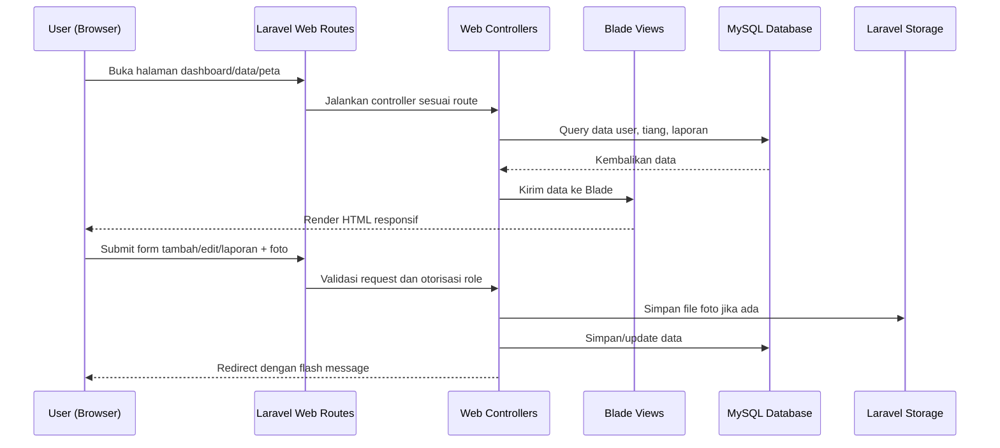
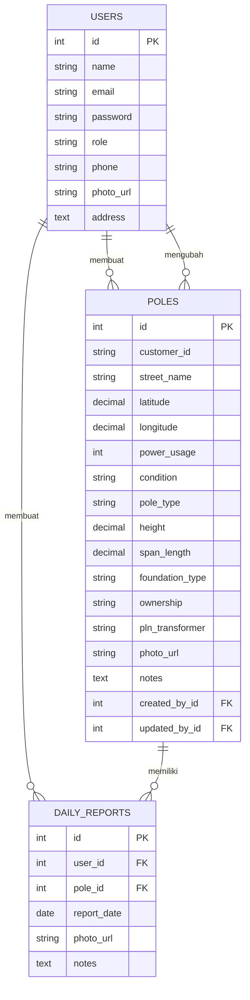

# PRD - Project Requirements Document

## 1. Overview

Aplikasi ini adalah sistem inventarisasi aset Penerangan Jalan Umum (PJU) berbasis web untuk membantu surveyor dan pengelola mendata tiang, memantau kondisi aset, mencatat penggunaan daya, melihat lokasi pada peta, serta membuat laporan aktivitas harian.

Sistem saat ini sudah berjalan sebagai aplikasi **full stack Laravel** di folder `backend/`. Frontend menggunakan **Laravel Blade**, route web Laravel, session login, form server-side, dan database MySQL. Frontend Next.js lama sudah tidak digunakan.

Tujuan utama aplikasi adalah membuat proses pendataan PJU menjadi lebih rapi, terpusat, mudah diakses dari perangkat lapangan, dan siap dideploy ke hosting berbasis PHP/Laravel melalui Git.

## 2. Requirements

- **Aksesibilitas:** Aplikasi berbentuk website responsif yang bisa dibuka melalui browser desktop, tablet, dan smartphone.
- **Autentikasi:** Pengguna harus login sebelum mengakses dashboard, data tiang, peta, laporan, profil, dan manajemen user.
- **Role-Based Access Control:** Sistem membedakan akses `superadmin`, `surveyor`, dan `user`.
- **Manajemen Data Aset:** Sistem menyimpan data tiang PJU beserta ID pelanggan, lokasi, koordinat, daya, kondisi, jenis tiang, pondasi, kepemilikan, trafo PLN, foto, dan catatan.
- **Peta Aset:** Sistem menampilkan titik koordinat tiang pada peta interaktif berbasis Leaflet/OpenStreetMap.
- **Pencarian dan Filter:** Pengguna dapat mencari aset berdasarkan teks dan memfilter berdasarkan kondisi.
- **Pelaporan Harian:** Sistem mencatat laporan aktivitas atau kerusakan tiang, termasuk foto dan catatan.
- **Audit Data:** Data tiang menyimpan informasi pembuat dan pengubah terakhir.
- **Deployment:** Aplikasi dapat dideploy ke hosting Laravel/shared hosting melalui Git dengan document root mengarah ke `backend/public`.

## 3. Core Features

- **Dashboard Operasional:** Menampilkan ringkasan total aset, kondisi tiang, total daya, aktivitas harian, peta ringkas, dan aset terbaru.
- **Data Tiang PJU:** Halaman daftar aset dengan pencarian, filter, pagination, tombol detail, tambah, edit, hapus, dan export data.
- **Detail Tiang:** Halaman detail aset yang menampilkan spesifikasi lengkap, informasi koordinat, audit input/update, dan riwayat laporan.
- **Peta Lokasi Tiang:** Halaman peta dengan marker aset, popup detail, filter, dan panel inspeksi.
- **Laporan Aktivitas:** Halaman rekap laporan harian serta laporan kerusakan yang dibuat surveyor.
- **Profil Pengguna:** Pengguna dapat memperbarui data profil dan password.
- **Manajemen User:** Superadmin dapat membuat, mengubah, dan menghapus akun pengguna.
- **Upload Foto:** Sistem mendukung upload foto aset dan laporan kerusakan ke storage Laravel.

## 4. User Flow

1. **Login:** Pengguna masuk melalui halaman login Laravel.
2. **Dashboard:** Pengguna melihat ringkasan kondisi aset, aktivitas harian, dan aset terbaru.
3. **Cari Aset:** Pengguna membuka Data Tiang atau Peta, lalu mencari berdasarkan ID pelanggan/nama jalan/kondisi.
4. **Tambah atau Update Tiang:** Superadmin atau surveyor menambah data tiang baru atau memperbarui data yang sudah ada.
5. **Lapor Kerusakan:** Superadmin atau surveyor memilih tiang, mengisi catatan, dan mengunggah foto laporan.
6. **Pantau Aktivitas:** Pengguna membuka halaman Aktivitas untuk melihat rekap laporan.
7. **Kelola User:** Superadmin membuka halaman Manajemen User untuk mengelola akun dan role.

## 5. Architecture

Aplikasi menggunakan arsitektur monolith Laravel. Browser pengguna berinteraksi langsung dengan route web Laravel. Controller mengambil data dari model Eloquent, Blade merender HTML, dan form dikirim kembali ke route Laravel dengan proteksi CSRF/session.

API Sanctum lama tetap tersedia untuk kebutuhan integrasi, tetapi antarmuka utama saat ini berjalan melalui Laravel Blade.



## 6. Database Schema

Sistem menggunakan database relasional MySQL dengan tabel utama berikut.

**1. Tabel `users`**

- `id`: ID unik pengguna.
- `name`: Nama lengkap.
- `email`: Email untuk login.
- `password`: Password terenkripsi.
- `role`: Role pengguna, yaitu `superadmin`, `surveyor`, atau `user`.
- `phone`: Nomor telepon.
- `photo_url`: Foto profil pengguna.
- `address`: Alamat pengguna.

**2. Tabel `poles`**

- `id`: ID unik tiang.
- `customer_id`: ID pelanggan/identitas aset, unik.
- `street_name`: Nama jalan/lokasi tiang.
- `latitude`: Koordinat latitude.
- `longitude`: Koordinat longitude.
- `power_usage`: Daya dalam watt.
- `condition`: Kondisi aset, misalnya `baik`, `rusak`, atau `perbaikan`.
- `pole_type`: Jenis tiang.
- `height`: Tinggi tiang.
- `span_length`: Panjang bentangan.
- `foundation_type`: Jenis pondasi.
- `ownership`: Kepemilikan aset.
- `pln_transformer`: Informasi trafo PLN.
- `photo_url`: Foto aset.
- `notes`: Catatan aset.
- `created_by_id`: User pembuat data.
- `updated_by_id`: User pengubah terakhir.

**3. Tabel `daily_reports`**

- `id`: ID unik laporan.
- `user_id`: Pengguna pembuat laporan.
- `pole_id`: Tiang terkait laporan.
- `report_date`: Tanggal laporan.
- `photo_url`: Foto laporan jika ada.
- `notes`: Catatan laporan.



## 7. Tech Stack

- **Full Stack Framework:** Laravel 12.
- **Frontend:** Laravel Blade, Tailwind utility classes, Lucide icons, dan JavaScript ringan di Blade/partial.
- **Backend:** Laravel Web Controllers, middleware auth/session, middleware role, Eloquent ORM, validation, file upload, dan route web.
- **API:** Laravel API routes + Sanctum tetap tersedia untuk integrasi, tetapi bukan antarmuka utama.
- **Database:** MySQL.
- **Map:** Leaflet.js dengan OpenStreetMap tile.
- **Storage:** Laravel public storage untuk foto aset/laporan.
- **Authentication:** Session-based Laravel auth untuk web; token Sanctum untuk API.
- **Deployment:** Git-based deployment ke hosting PHP/Laravel. Repository dideploy ke folder non-public, document root diarahkan ke `backend/public`, dan script `backend/scripts/deploy.sh` menjalankan composer install, migrate, storage link, dan cache.

## 8. Deployment Requirement

- Hosting mendukung PHP 8.2+, Composer, MySQL, SSH/Git, dan document root custom.
- Repository diclone ke folder non-public, contoh `/home/username/repositories/apptiang2`.
- Document root domain diarahkan ke `/home/username/repositories/apptiang2/backend/public`.
- File `.env` production dibuat dari `backend/.env.production.example`.
- Deploy dijalankan dengan:

```bash
git pull origin main
bash backend/scripts/deploy.sh
```

- Seeder utama tidak dijalankan otomatis di production karena dapat mengisi ulang data sample. Jika butuh akun awal, jalankan `RbacUsersSeeder` secara manual satu kali.
