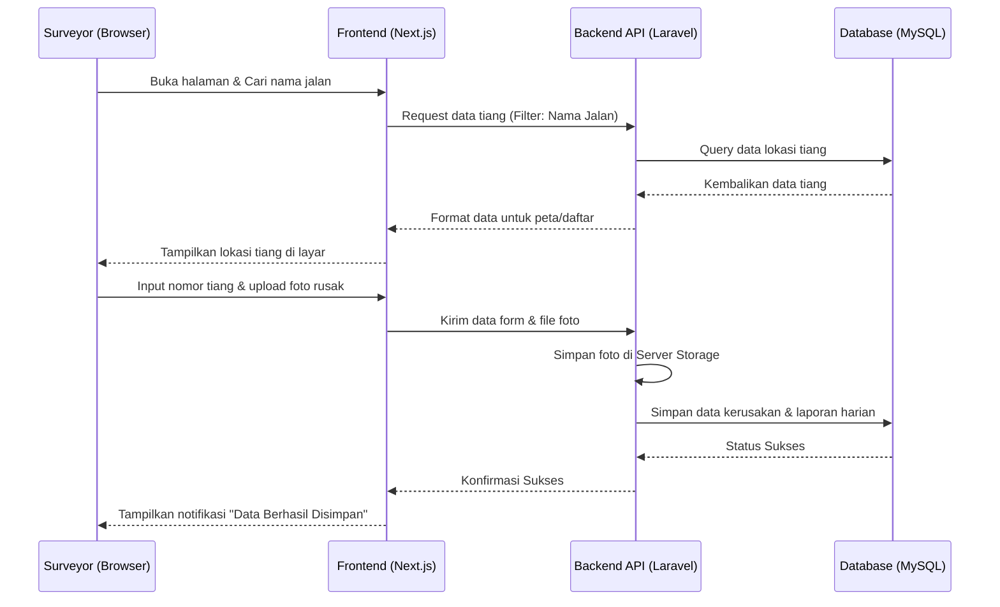
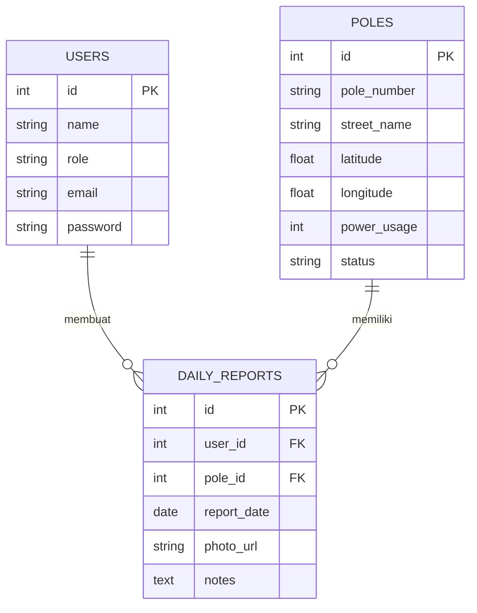

# PRD — Project Requirements Document

## 1. Overview
Saat ini, surveyor mendata tiang listrik untuk Penerangan Jalan Umum (PJU) tanpa sistem digital, sehingga pencatatan aset pemerintah dan pemantauan penggunaan daya menjadi tidak terstruktur. Aplikasi berbasis website ini dibangun untuk mendigitalisasi proses inventarisasi tiang PJU. Dengan aplikasi ini, surveyor dapat dengan mudah melacak lokasi tiang, mencatat kondisi serta penggunaan daya, dan membuat laporan harian. Tujuan utamanya adalah menciptakan sistem pendataan yang jauh **lebih rapi**, terpusat, dan mudah diakses secara real-time.

## 2. Requirements
- **Aksesibilitas:** Aplikasi berbentuk website yang responsif, sehingga surveyor dapat membukanya melalui browser di *smartphone* maupun tablet saat berada di lapangan.
- **Manajemen Data Aset:** Mampu menyimpan ratusan hingga ribuan data tiang listrik beserta spesifikasinya (nomor tiang, daya, lokasi).
- **Pemrosesan Media:** Mendukung fitur unggah foto untuk mendokumentasikan tiang yang rusak.
- **Sistem Pelaporan:** Aplikasi harus bisa membuat rekapitulasi atau laporan harian dari aktivitas pendataan surveyor.
- **Keamanan:** Sistem login sederhana untuk memastikan hanya surveyor dan admin resmi yang dapat mengubah data aset pemerintah.

## 3. Core Features
- **Peta Lokasi & Pencarian Tiang:** Peta interaktif yang memungkinkan surveyor mencari tiang berdasarkan **nama jalan** dan menemukan lokasi tiang listrik di sekitarnya dengan cepat.
- **Pendataan Tiang (Data Entry):** Form digital untuk mencatat nomor identitas tiang, besaran penggunaan daya, serta status kondisi tiang.
- **Pelaporan Kerusakan (Photo Upload):** Fitur untuk mengambil atau mengunggah foto langsung dari lapangan jika ditemukan tiang PJU yang rusak, lengkap beserta catatan kerusakannya.
- **Laporan Harian:** Dasbor khusus yang merangkum data tiang apa saja yang sudah didata atau dilaporkan rusak pada hari tersebut, sehingga surveyor memiliki kepuasan kerja dan rutinitas harian di dalam aplikasi.

## 4. User Flow
1. **Login:** Surveyor masuk ke dalam aplikasi menggunakan kredensial mereka.
2. **Cari Lokasi:** Di halaman utama, surveyor melihat peta atau daftar jalan. Mereka mengetikkan nama jalan tempat mereka sedang bertugas.
3. **Pilih / Tambah Tiang:** Surveyor melihat titik tiang di jalan tersebut. Jika tiang belum ada di sistem, mereka membuat data baru (masukkan nomor tiang dan daya).
4. **Cek Kondisi & Lapor Kerusakan:** Surveyor memperbarui status tiang. Jika tiang rusak, mereka memotret kerusakan tersebut lalu mengunggah fotonya ke dalam sistem.
5. **Laporan Harian:** Pada akhir jam kerja, surveyor membuka menu Laporan Harian untuk melihat rekap jalan mana saja dan berapa tiang yang berhasil didata hari itu sebelum menutup aplikasi.

## 5. Architecture
Aplikasi ini menggunakan arsitektur modern yang memisahkan antara tampilan depan (Frontend) dan sistem pengolahan data di belakang layar (Backend). Frontend akan menangani antarmuka peta dan form untuk pengguna, sementara Backend akan memproses logika bisnis, menyimpan foto, dan berkomunikasi dengan Database.

## 6. Database Schema
Sistem ini menggunakan struktur data relasional untuk menjaga data tetap tersusun rapi. Berikut adalah tabel-tabel utamanya:

**1. Tabel `users`** (Menyimpan data surveyor dan admin)
- `id` (Integer): ID unik pengguna.
- `name` (String): Nama lengkap.
- `role` (String): Peran pengguna (contoh: 'surveyor', 'admin').
- `email` (String): Email untuk login.
- `password` (String): Kata sandi terenkripsi.

**2. Tabel `poles`** (Menyimpan data induk tiang PJU)
- `id` (Integer): ID unik tiang di sistem.
- `pole_number` (String): Nomor identitas fisik tiang di lapangan.
- `street_name` (String): Nama jalan lokasi tiang.
- `latitude` (Float): Koordinat peta (Garis Lintang).
- `longitude` (Float): Koordinat peta (Garis Bujur).
- `power_usage` (Integer): Penggunaan daya tiang (dalam Watt).
- `status` (String): Kondisi saat ini (contoh: 'baik', 'rusak', 'perbaikan').

**3. Tabel `daily_reports`** (Menyimpan laporan aktivitas harian & laporan kerusakan)
- `id` (Integer): ID unik laporan.
- `user_id` (Integer): Penghubung ke tabel *users* (siapa yang melapor).
- `pole_id` (Integer): Penghubung ke tabel *poles* (tiang mana yang dilaporkan).
- `report_date` (Date): Tanggal pendataan/pelaporan.
- `photo_url` (String): Link/alamat file foto jika tiang rusak (opsional).
- `notes` (Text): Catatan tambahan dari surveyor.

## 7. Tech Stack
Berdasarkan kebutuhan sistem yang rapi serta input yang diberikan, berikut adalah rekomendasi teknologinya:

- **Frontend:** **Next.js** (Framework React). Dipilih untuk menghasilkan website yang cepat dan responsif saat dibuka di HP surveyor.
- **UI Framework:** **Tailwind CSS** dipadukan dengan **shadcn/ui**. Ini akan memastikan tampilan UI sistem pelaporan sangat rapi, bersih, dan terlihat profesional.
- **Peta (Mappping):** **Leaflet.js** atau **Google Maps API** (diintegrasikan di dalam Next.js) untuk fitur visualisasi titik lokasi tiang listrik.
- **Backend:** **Laravel**. Framework PHP yang sangat kuat dalam menangani API (Application Programming Interface), pemrosesan logika harian, serta manajemen unggah file gambar/foto.
- **Database:** **MySQL**. Database relasional yang sangat cocok dan stabil untuk menyimpan data aset pemerintah yang terstruktur.
- **Deployment (AI Pilihan):** 
  - *Frontend:* **Vercel** (Gratis dan dioptimalkan sempurna untuk Next.js).
  - *Backend & Database:* **DigitalOcean App Platform** atau **Railway**. Platform ini menawarkan auto-deployment yang mudah untuk proyek Laravel dan integrasi database MySQL tanpa harus pusing mengelola server secara manual. Storage foto bisa memanfaatkan Amazon S3 atau DigitalOcean Spaces agar aplikasi tidak memberatkan server utama.